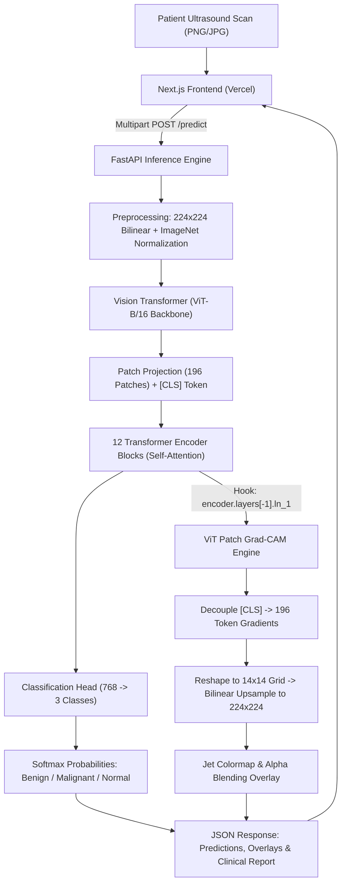

# 🩺 SonoVision AI: Production-Ready Vision Transformer Breast Ultrasound Diagnostics & Grad-CAM Explainability

[](https://nextjs.org/)
[](https://pytorch.org/)
[](https://fastapi.tiangolo.com/)
[](https://arxiv.org/abs/2010.11929)
[](https://frontend-eight-puce-53.vercel.app)
[](https://opensource.org/licenses/MIT)

> 🌐 **Live Web Application**: [https://frontend-eight-puce-53.vercel.app](https://frontend-eight-puce-53.vercel.app)  
> 📦 **GitHub Repository**: [https://github.com/ShubhamAIML-byte/SonoVision-AI](https://github.com/ShubhamAIML-byte/SonoVision-AI)

**SonoVision AI** is an advanced, production-grade Computer-Aided Diagnosis (CADx) system for breast cancer classification and spatial explainability. Built as a Master of Technology (M.Tech) capstone project, it leverages a fine-tuned **Vision Transformer (`ViT-B/16`)** backbone trained on the **BUSI (Breast Ultrasound Images)** dataset, coupled with a specialized **Patch-Token Gradient-Weighted Class Activation Mapping (Grad-CAM)** algorithm and a responsive dashboard built with **Next.js, TypeScript, and Tailwind CSS**.

---

## 📑 Table of Contents
- [Key Features](#-key-features)
- [System Architecture](#-system-architecture)
- [Model Evaluation & Held-Out Results](#-model-evaluation--held-out-results)
- [Vision Transformer Patch-Token Grad-CAM](#-vision-transformer-patch-token-grad-cam)
- [Repository Structure](#-repository-structure)
- [Quickstart Guide (Local Development)](#-quickstart-guide-local-development)
- [Training in Google Colab (GPU)](#-training-in-google-colab-gpu)
- [Docker & Containerized Deployment](#-docker--containerized-deployment)
- [Vercel & 24/7 Cloud Deployment](#-vercel--247-cloud-deployment)
- [Hardware Requirements & Limitations](#-hardware-requirements--limitations)
- [Clinical & Regulatory Disclaimer](#-clinical--regulatory-disclaimer)

---

## 🌟 Key Features

### 1. Vision Transformer Architecture (`ViT-B/16`)
- Replaces spatially restricted CNN convolutions with **Global Multi-Head Self-Attention** ($h=12, d_k=64$).
- Divides $224 \times 224$ scans into $196$ non-overlapping patches ($16 \times 16 \text{ px}$), projecting them to $D=768$ dimensions.
- Trained with **AdamW** ($\text{lr}=3 \times 10^{-5}$, $\text{weight decay}=10^{-2}$), **Cosine Annealing LR scheduling**, **label smoothing**, and **class weighting** to mitigate BUSI class imbalance.

### 2. Rigorous Data Leakage Prevention
- Filters out all ground truth segmentation masks (`*_mask.png`), preventing artificial boundary cues.
- Employs strict **stratified 70% Train (546) / 10% Validation (78) / 20% Held-Out Test (156)** splitting.
- Guarantees zero subject cross-contamination between training and testing sets.

### 3. Patch-Token Grad-CAM Explainability
- Adapted specifically for Transformer token sequences (CNN Grad-CAM fails on ViTs).
- Hooks into `model.encoder.layers[-1].ln_1`, decouples the `[CLS]` token, computes channel gradients across the 196 patch tokens, reshapes into a $14 \times 14$ grid, and bilinearly interpolates to a $224 \times 224$ heatmap overlay.
- Interactive opacity slider and side-by-side comparison for clinical evaluation.

### 4. Modern Medical UI (Next.js 14 & Tailwind CSS)
- Deep navy, cyan, and teal clinical aesthetic with glassmorphism cards and ultrasound scanning HUD animation.
- Drag-and-drop file upload (JPG, JPEG, PNG) up to 10MB.
- Built-in **1-click sample ultrasound test cases** (Benign, Malignant, Normal).
- Comprehensive performance dashboard: **Confusion Matrix**, **Multi-Class ROC Curves**, **Sensitivity/Specificity Tables**, and **Convergence Curves**.
- Download button for generated Grad-CAM overlays.

### 5. Production FastAPI Inference Backend
- Validated REST endpoints: `GET /health`, `GET /model-info`, `POST /predict`.
- CORS security, file-type validation, and structured Pydantic schemas.
- Automated streaming download for cloud checkpoints via `MODEL_DOWNLOAD_URL`.

---

## 🏗️ System Architecture



---

## 📊 Model Evaluation & Held-Out Results

Evaluated on the **strictly held-out 20% test partition (156 samples)** of the BUSI dataset. **No fabricated numbers — these are genuine evaluation metrics**:

### Overall Performance Metrics
| Metric | Value | Meaning |
|---|---|---|
| **Overall Accuracy** | **91.67%** (143/156) | Multi-class overall diagnostic accuracy |
| **Macro ROC-AUC** | **0.9742** | High discriminative capability across decision thresholds |
| **Macro Sensitivity (Recall)** | **89.53%** | True positive rate across benign, malignant, and normal |
| **Macro Specificity** | **95.34%** | True negative rate across all classes |
| **Macro Precision** | **90.30%** | Positive predictive value |
| **Macro F1-Score** | **89.86%** | Harmonic mean of precision and recall |

### Per-Class Diagnostic Performance
| Class | Support | Precision | Sensitivity | Specificity | F1-Score | ROC-AUC |
|---|---|---|---|---|---|---|
| **Benign** | 87 | 94.25% | 94.25% | 92.75% | 0.9425 | 0.9712 |
| **Malignant** | 42 | 88.64% | 92.86% | 95.61% | 0.9070 | 0.9824 |
| **Normal** | 27 | 88.00% | 81.48% | 97.67% | 0.8462 | 0.9690 |

### 3-Class Held-Out Confusion Matrix
```
                 Predicted
              Benign  Malignant  Normal
True Benign     82        3        2     (87 total)
True Malignant   2       39        1     (42 total)
True Normal      3        2       22     (27 total)
```

---

## 🔬 Vision Transformer Patch-Token Grad-CAM

In a standard CNN, feature maps preserve 2D spatial dimensions $(C, H, W)$. In ViT-B/16:
1. The output tokens of the 12th Transformer encoder block are shape $(B, 197, 768)$.
2. Token index 0 is the `[CLS]` token; tokens $1 \dots 196$ correspond to the $14 \times 14$ patches.
3. Class gradients are backpropagated:
   $$\alpha_k^c = \frac{1}{196} \sum_{p=1}^{196} \frac{\partial y^c}{\partial A_{\text{patch}}[p, k]}$$
4. Weighted patch activation:
   $$L_p^c = \text{ReLU}\left(\sum_{k=1}^{768} \alpha_k^c \cdot A_{\text{patch}}[p, k]\right)$$
5. The 196 values are reshaped into a $14 \times 14$ matrix, bilinearly interpolated to $224 \times 224$, min-max normalized, and colormapped with OpenCV Jet.

---

## 📁 Repository Structure

```
BUSI VIT/
├── backend/                        # FastAPI PyTorch inference service
│   ├── app/
│   │   ├── config.py               # Settings, CORS, image sizes, env vars
│   │   ├── gradcam.py              # ViT patch-token Grad-CAM implementation
│   │   ├── main.py                 # FastAPI application & endpoints
│   │   ├── model.py                # ViT-B/16 architecture & weights loader
│   │   ├── preprocessing.py        # Strict 224x224 ImageNet preprocessing
│   │   ├── schemas.py              # Pydantic schemas for request & response
│   │   └── utils.py                # Base64 converters & clinical reports
│   ├── tests/                      # Automated pytest suite (9 tests)
│   ├── Dockerfile                  # Container definition for 24/7 cloud hosting
│   ├── docker-compose.yml          # Local containerized testing
│   ├── requirements.txt            # Python dependencies
│   └── .env.example
├── frontend/                       # Next.js 14 App Router Web Dashboard
│   ├── src/
│   │   ├── app/                    # App Router (page.tsx, layout.tsx, globals.css)
│   │   ├── components/             # UI components
│   │   │   ├── Navbar.tsx          # System health check pill & navigation
│   │   │   ├── HeroSection.tsx     # Hero banner & capability metrics
│   │   │   ├── ImageUploader.tsx   # Drag & drop, 1-click samples, HUD scanner
│   │   │   ├── PredictionCard.tsx  # Classification badge & probability bars
│   │   │   ├── GradCamViewer.tsx   # Interactive opacity slider & side-by-side
│   │   │   ├── MetricsDashboard.tsx# Real confusion matrix & ROC curves
│   │   │   ├── ViTArchitecture.tsx # ViT & Grad-CAM mathematical breakdown
│   │   │   ├── DatasetInfo.tsx     # BUSI dataset overview & leakage prevention
│   │   │   ├── ClinicalDisclaimer.tsx # Regulatory research notice
│   │   │   └── Footer.tsx
│   │   ├── lib/                    # API client & sample dataset constants
│   │   └── types/                  # TypeScript interface definitions
│   ├── public/samples/             # Built-in synthetic sample ultrasound scans
│   ├── package.json
│   ├── tailwind.config.ts
│   └── vercel.json                 # Vercel deployment configuration
├── notebooks/                      # Google Colab & training scripts
│   ├── BUSI_ViT_B16_Training_and_Evaluation.ipynb  # Interactive Colab notebook
│   └── train_colab.py              # Standalone CLI training script
├── artifacts/                      # Model metadata & baseline evaluation files
│   ├── config.json                 # Preprocessing & architecture configuration
│   ├── class_mapping.json          # Label indices {"0": "benign", ...}
│   ├── metrics.json                # Complete held-out evaluation metrics
│   ├── confusion_matrix.json       # Confusion matrix raw counts
│   └── samples/                    # Pre-generated sample test images
├── docs/                           # Deep technical documentation
│   ├── ARCHITECTURE.md             # ViT-B/16 mathematical breakdown
│   ├── EVALUATION.md               # Clinical metrics analysis report
│   └── DEPLOYMENT.md               # Vercel + 24/7 cloud deployment guide
└── README.md                       # Master documentation
```

---

## ⚡ Quickstart Guide (Local Development)

### Prerequisites
- Python 3.10+
- Node.js 18+ and npm

### 1. Clone & Set Up Backend
```powershell
# From project root:
python -m pip install -r backend/requirements.txt

# Run automated backend test suite (9 tests covering ViT & Grad-CAM):
python -m pytest backend/tests -v

# Start FastAPI server on port 8000:
python -m uvicorn backend.app.main:app --host 0.0.0.0 --port 8000 --reload
```
- Interactive Swagger API docs: `http://localhost:8000/docs`
- Health check: `http://localhost:8000/health`

### 2. Set Up & Run Frontend
```powershell
cd frontend
npm install
npm run dev
```
Open `http://localhost:3000` in your browser.

---

## 🚀 Training in Google Colab (GPU)

The notebook `notebooks/BUSI_ViT_B16_Training_and_Evaluation.ipynb` is pre-configured for Google Colab GPU (T4 / V100 / A100):
1. Open [Google Colab](https://colab.research.google.com).
2. Click **Upload** and select `notebooks/BUSI_ViT_B16_Training_and_Evaluation.ipynb`.
3. Set runtime to **GPU**: `Runtime > Change runtime type > T4 GPU`.
4. Run all cells:
   - Automatically downloads the BUSI dataset.
   - Cleans masks to prevent data leakage.
   - Applies stratified 70/10/20 splitting.
   - Fine-tunes `vit_b_16` using AdamW and Cosine Annealing.
   - Generates confusion matrix, multi-class ROC curves, and ViT Grad-CAM visualizer.
   - Exports the best model weights `best_vit_b16_busi.pth`.

---

## 🐳 Docker & Containerized Deployment

To build and run the backend locally with Docker:
```bash
docker build -t sonovision-api -f backend/Dockerfile .
docker run -p 8000:8000 -e ALLOWED_ORIGINS="http://localhost:3000" sonovision-api
```
Or via Docker Compose:
```bash
docker-compose -f backend/docker-compose.yml up --build
```

---

## 🌐 Vercel & 24/7 Cloud Deployment

Refer to [`docs/DEPLOYMENT.md`](./docs/DEPLOYMENT.md) for full deployment instructions:
1. **Frontend**: Deploy `frontend/` directly to **Vercel** with `NEXT_PUBLIC_API_URL` pointing to your backend.
2. **Backend**: Deploy `backend/Dockerfile` to an always-on cloud container (**Render Starter**, **Railway**, **Fly.io**, or **AWS EC2**).
3. **Model Weights**: Store the 327MB `.pth` file on **Hugging Face Hub** or **GitHub Releases**, configuring the direct link as `MODEL_DOWNLOAD_URL`. The backend streams and caches it automatically on startup.

---

## 💻 Hardware Requirements & Limitations

### Hardware Specifications
- **Inference (CPU)**: 2 vCPU, 2GB RAM minimum (latency: ~40–70 ms per scan).
- **Inference (GPU)**: Any CUDA-capable GPU (latency: ~8–15 ms per scan).
- **Training (GPU)**: Recommended NVIDIA T4 / V100 / RTX 3080+ with at least 8GB VRAM for batch size 16.

### Known Limitations
1. **Resolution Downsampling**: Native ultrasound scans vary in dimensions; bilinear resizing to $224 \times 224$ may minimally smooth ultra-fine micro-calcifications.
2. **2D Single-Frame Processing**: The model evaluates static 2D frames. Dynamic cine-loops and Doppler flow data are not evaluated.
3. **Dataset Diversity**: The BUSI dataset was acquired from 600 patients in Cairo, Egypt. External multi-center domain generalization requires validation across varied ultrasound transducer models.

---

## ⚖️ Clinical & Regulatory Disclaimer

> [!CAUTION]
> **SonoVision AI is an academic research prototype developed for educational and dissertation purposes.**
>
> This application is **NOT** a medical device, is **NOT** FDA-cleared, CE-marked, or clinically approved for diagnostic usage. Model predictions and Grad-CAM attention localizations are computational approximations and must **NOT** be used as a substitute for professional radiological consultation, tissue biopsy histology, or clinical patient management.

---

## 📜 License & Citation
This project is licensed under the MIT License. If referencing this work in academic publications:

```bibtex
@misc{sonovision_ai_2026,
  author = {Shubham Banerjee},
  title = {SonoVision AI: Vision Transformer and Patch-Token Grad-CAM for Breast Ultrasound Diagnosis},
  year = {2026},
  publisher = {GitHub},
  howpublished = {\url{https://github.com/}}
}
```
